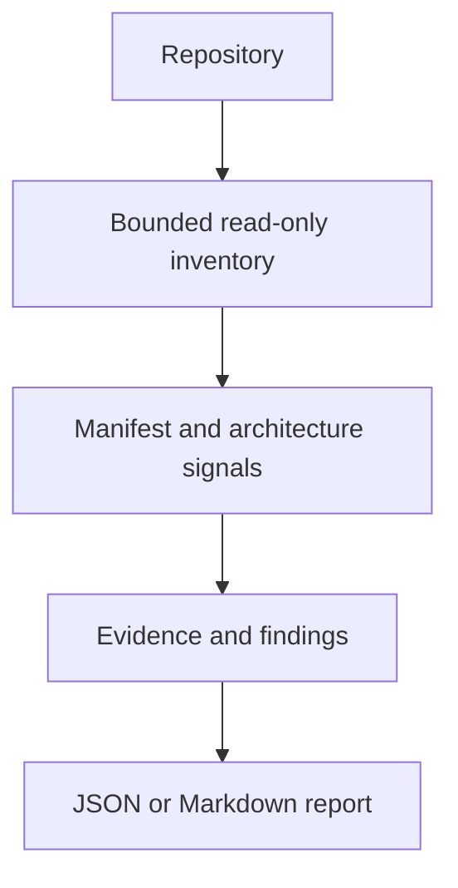

# Agent-Universal-Devkit

A modular, vendor-neutral engineering ecosystem for AI agents and the people who direct them. It combines Resource Intelligence, native engineering knowledge, task planning, policy decisions, and independent verification.

The long-term product is a unified problem-solving workbench: one entry point and shared workflow for supported problems, powered by a small universal core and optional domain, integration, and interface packs. It integrates existing tools and agents rather than trying to replace them. It is not tied to one model, vendor, agent harness, language, or deployment model.

See [Unified Problem-Solving Model](docs/UNIFIED-PROBLEM-SOLVING-MODEL.md) for the intended product direction. This is a future target, not a claim that the full workbench exists today.

## Two equal priorities

1. **Resource Intelligence:** discover, inspect, compare, relate, and maintain external engineering resources.
2. **Agent Orchestration:** understand goals, plan work, evaluate actions, route tasks, execute through adapters, and verify results.

The native **Engineering Knowledge & Methods Library** supports both priorities. It stores original material on algorithms, mathematics, methods, and engineering procedures.

## What exists now

- Resource catalog with candidate and approval distinctions.
- Requirement-based resource comparison with hard constraints before weighted ranking.
- SQLite resource registry with canonical identity, metadata sync, and human-reviewed deduplication.
- Native knowledge library and deterministic, approved-only retrieval.
- Knowledge schema, relationship, approval-attestation, and content-digest checks.
- Technology Decision Engine for opt-in, evidence-backed architecture comparisons.
- Initial shared problem contracts for problems, evidence, findings, capabilities, plans, and verification, with strict versioned schemas.
- Deterministic capability filtering and ranking with deny-by-default permission and execution-mode checks.
- Read-only repository discovery and an initial evidence-backed repo-scan workflow, with JSON/Markdown CLI reports and deterministic entry-point/workspace signals.
- Task planner with dependency ordering and policy evaluation.
- Versioned Policy Engine with a deny-by-default action catalogue and plan-bound approval records.
- Repository governance, project-type rubrics, bootstrap guidance, and a read-only hygiene checker.
- GitHub workflows for tests, quality checks, CodeQL, and secret-history scanning.
- Project intelligence and continuity protocol with durable project-state and work-log templates for agent handoffs.
- A README Demonstration Standard that requires new projects to show real working behaviour through GIFs, screenshots, interactive demos, or project-appropriate alternatives.

These are implemented foundations. They do not yet form a complete autonomous execution platform.

## Demo

The first end-to-end workflow is a read-only repository scan. Run it from the repository root:

```bash
node core/project-intelligence/bin/repo-scan.js . --format markdown
```

The command prints a Markdown report with detected project signals, evidence-backed findings, and scan limitations. It does not run project scripts, install dependencies, access the network, or write to the scanned repository.



This CLI-first example is the current reproducible demonstration. A terminal GIF will be added only after it can be captured from a verified live run. The README will not use a simulated terminal image.

## Current architecture

| Path | Responsibility |
|---|---|
| `catalog/` | External resource candidates and discovery metadata |
| `knowledge/` | Original engineering knowledge |
| `core/schema-engine/` | Shared validation for DEVKIT's documented JSON Schema subset |
| `core/project-intelligence/` | Read-only repository discovery and initial repo-scan findings |
| `core/capability-engine/` | Filters and ranks declared capabilities against problem context and granted permissions |
| `core/problem-engine/` | Versioned shared problem, evidence, finding, capability, plan, and verification contracts |
| `core/knowledge-engine/` | Deterministic knowledge retrieval and validation |
| `core/resource-engine/` | Requirement-based resource evaluation |
| `core/resource-registry/` | SQLite resource identity, metadata, and review history |
| `core/orchestrator/` | Planning, technology assessment, policy evaluation, and safety gates |
| `agents/` | Shared guidance and harness adapter entry points |
| `integrations/` | External system integrations |
| `bootstrap/template/` | Small entry-point files and continuity templates for connected repositories |
| `schemas/` | Machine-readable contracts |
| `scripts/` | Discovery and repository maintenance |
| `docs/` | Product, architecture, security, quality, continuity, and roadmap records |
| `rubrics/` | Universal and specialist project quality criteria |

## Policy and execution boundary

The Policy Engine evaluates known actions and denies unknown actions. It can require a scoped approval record tied to the exact action, target, policy version, plan ID, and plan digest. A trusted `verifyApproval` callback must validate the approval.

**Important:** the Policy Engine is a decision core. It does not authenticate people, store approval records, prevent replay by itself, execute tools, or enforce operating-system permissions. No executor adapter currently enforces policy at the point of action. Do not describe this repository as a secure agent execution platform.

## Start here

1. Read [Vision and Scope](docs/VISION-AND-SCOPE.md).
2. Read [Product Principles](docs/PRODUCT-PRINCIPLES.md) and [Architecture](docs/ARCHITECTURE.md).
3. Read [Repository Governance](docs/REPOSITORY-GOVERNANCE.md).
4. Read [Project Intelligence and Continuity](docs/PROJECT-INTELLIGENCE-AND-CONTINUITY.md).
5. Read [README Demonstration Standard](docs/README-DEMO-STANDARD.md) before creating a repository or major user-facing feature.
6. Read [Technology Architecture Selection](docs/TECHNOLOGY-ARCHITECTURE-SELECTION.md).
7. Read [Roadmap](docs/ROADMAP.md) for implemented work and remaining gates.
8. Read [AGENTS.md](AGENTS.md) before using an AI agent in this repository.

Run the read-only hygiene check:

```bash
node scripts/repository-hygiene/check.mjs
```

Run subsystem tests from their package directories with the scripts defined in each `package.json`. Shared contract tests run in `.github/workflows/problem-engine-tests.yml`. See each subsystem README for scope and limitations.

## Important operating rules

- Popularity is a discovery signal, not proof of quality.
- Discovery does not mean approval, installation, or execution.
- Apply hard requirements before weighted comparison.
- Keep facts, assessments, assumptions, and decisions distinct.
- Retrieve only relevant knowledge. Draft and review entries are not validated guidance.
- Never treat an agent's completion statement as verification.
- Use least privilege and risk-based human approval.
- Do not claim support for an agent harness until its adapter is tested.
- Do not claim security, compliance, or production readiness without evidence.
- Keep project state and work history in the repository so a replacement agent can continue without prior chat access.

## Current limitations

- The orchestrator plans and evaluates policy. It does not launch or coordinate real agent processes.
- Executor-side policy enforcement and approval lifecycle management remain future work.
- Agent harness directories are mostly planned entry points, not validated adapters.
- Pack manifests define a governance contract. Runtime installation, activation, dependency resolution, and safe removal are not implemented.
- Knowledge retrieval is deterministic metadata matching. It does not understand arbitrary paraphrases or prove applicability.
- Resource sync gathers GitHub metadata. It is not a full source, dependency, security, or legal audit.
- Repository branch protection and security settings require owner-side verification. Documentation does not prove that settings are enabled.
- Continuity checks require project-state and work-log records, validate key handoff sections and review dates, and check that meaningful documentation/code changes update the records. They cannot prove that the recorded content is true or complete.

## Security and licensing

See [SECURITY.md](SECURITY.md), [policies/SECURITY.md](policies/SECURITY.md), and [Security Audit](docs/SECURITY-AUDIT.md). Report vulnerabilities through GitHub's private reporting path when available.

The Devkit's original code and documentation use the MIT License. Third-party resources retain their own licenses and terms.
